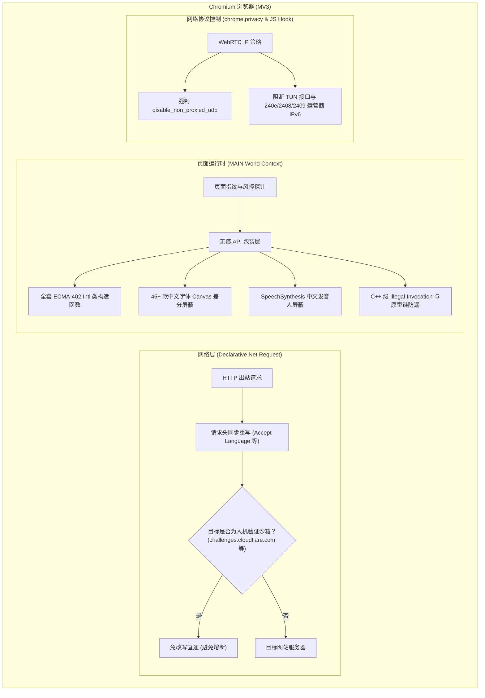

<div align="center">


# VanishMe · 消失的我

### 基于 Chrome MV3 的浏览器指纹伪装与环境一致性扩展，专克严苛风控与大模型地区封锁

[-blue.svg)](https://www.google.com/chrome/)
[](https://github.com/XiNian-dada/VanishMe/releases)
[](LICENSE)

[中文说明](#核心概述) | [English Documentation](#overview)

</div>

---

## 核心概述

现代网站在进行风控画像与地域审查时，早已超越了单纯的 IP 检查，而是通过深度探测浏览器底层软硬件特征建立全方位检测模型：

1. **时区与经纬度矛盾**：代理节点在美西洛杉矶（UTC-8），但浏览器系统时区依然暴露中国标准时间（UTC+8）。
2. **国际化与语言底层泄露**：操作系统语言虽设为英文，但 JavaScript `Intl` 全套 API 仍会暴露真实的中文区域格式。
3. **本地中文字体嗅探**：宿主机安装的微软雅黑、苹方、宋体等字体通过 Canvas 差分度量探针一秒识破。
4. **系统语音引擎出卖语种**：系统 TTS 注册的中文发音人（如婷婷、Eddy 等）暴露了真实系统语系。
5. **WebRTC 穿透**：网页通过 STUN 协议直接绕过代理，穿透出局域网内网 IP 或国内物理运营商 IPv4/IPv6。
6. **劣质插件被识破**：传统反指纹脚本粗暴覆写原生方法，在 CreepJS / DataDome 的原型描述符、Illegal Invocation 和堆栈检测下一触即溃。

**VanishMe** 专为消除上述环境冲突而设计。通过在网络层与 JavaScript 运行时同时进行原子级校准，使浏览器的指纹表现与代理出口环境完全一致。

> [!IMPORTANT]
> **使用前提与定位声明 (Prerequisites & Scope)**
> - **环境一致性校准**：VanishMe 的职责是将客户端指纹（时区、地理位置、语言、请求头、字体、语音模型）与你的代理节点对齐。
> - **非代理服务**：本扩展**不提供代理或翻墙能力**，必须与系统代理或代理扩展（如 Clash、Sing-box、SwitchyOmega 等）配合使用。

---

## 工作原理

VanishMe 采用网络层与运行时双层协同架构，避免了传统单层脚本“表里不一”或被反篡改脚本检测的问题：



---

## 核心特性 (v1.2.4)

### 1. 深度人机验证与现代应用兼容
- **Cloudflare Turnstile / Challenge 完美兼容**：自动识别并绝对豁免第三方安全验证沙箱（`challenges.cloudflare.com`、`hcaptcha.com` 等），验证沙箱内不注入代码且豁免 DNR 请求头改写，彻底根除 `Error: 600010`。
- **OpenAI / MFA 登录白屏修复**：全量保留继承 `Intl` 构造函数家族的静态方法（如 `supportedLocalesOf`）与 `RTCPeerConnection` 静态属性，杜绝现代前端框架因静态方法丢失而崩溃。
- **跨域 Iframe 隔离重构**：重构同源策略边界安全判定，根除读取 `contentWindow` 触发的 `SecurityError`，无缝兼容 Auth0 与第三方支付沙箱。

### 2. CreepJS / DataDome 级原生隐蔽度
- **C++ 级 Illegal Invocation 严密防御**：以非合规 receiver（如 `{}`、`null` 或 `Navigator.prototype`）调用 Getter 时，精准抛出 V8 原生 `TypeError: Illegal invocation`。
- **ECMA-402 规范与纯净原型链**：重构 `NumberFormat`、`DateTimeFormat`、`Collator` 等全系列构造函数，无 `resolvedOptions` 假自有属性残留，保持 100% 构造器引用一致。
- **原生方法 WebIDL 规范合规**：消除 `noProto` 破绽，原生方法严禁通过 `new` 调用且无 `.prototype` 暴露。
- **Detached Iframe 对抗与堆栈净化**：拦截 `contentWindow` 防止孤儿窗口逃逸，全场景净化 `Error.stack`，零插件路径字串残留。

### 3. 多模态物理与网络特征阻断
- **WebRTC STUN 物理 IP & 运营商 IPv6 阻断**：不仅阻断内网与 TUN 旁路 IP，更能深度拦截电信/联通/移动物理 IPv6（`240e`/`2408`/`2409`）候选外泄。
- **45+ 款典型中文字体 Canvas 差分屏蔽**：扩充中文字体库，全面防御基于 Canvas `measureText` 和 `document.fonts.check` 的字体探针。
- **系统语音发音人 (SpeechSynthesis) 屏蔽**：自动过滤宿主机系统注册的中文发音人模型（婷婷、Eddy 等），封堵商业语种探针。

### 4. 双层网络同步与内置排查中心
- **网络层与 JS 运行时“表里如一”**：DNR 规则重写 `Accept-Language` 与页面环境 100% 对齐，杜绝矛盾。
- **内置工业级隐私排查中心 (`leak-test.html`)**：对标 iplark、browserscan、iprisk 工业级规范。提供本地 0 依赖超严苛体检中心，一键排查时区、语言、Intl、字体、语音与 IP 穿透。
- **开箱即用地区预设**：内置美国（洛杉矶）、日本、新加坡、德国等常用地域预设，点击即可自动配置全套参数。

---

## 运行模式

根据业务需求，VanishMe 提供三种灵活的规则匹配机制：

| 模式 | 运作机制 | 推荐场景 |
|:---|:---|:---|
| **白名单模式 (推荐)** | 仅对指定域名启用伪装，其余网站完全保持原始环境 | 平常日常使用，仅在访问 Claude、ChatGPT、海外平台时生效，完全不影响国内网站体验 |
| **全局模式** | 对所有访问的网页统一启用伪装 | 深度隐私需求，或全流程跨境运维环境 |
| **黑名单模式** | 默认全量伪装，仅排除列表中的指定站点 | 绝大部分网站需要隔离，少数已知可信站点直通 |

> [!TIP]
> **名单规则**：在目标网站的 Popup 面板中选择“仅当前域名”或“包含子域名”，再添加到当前白名单 / 黑名单。`example.com` 仅精确匹配，`*.example.com` 同时匹配主域名和所有子域名；不会自动扩大到当前域名的父域名。空黑名单表示默认启用，检测网站不会自动补回名单。
>
> **站点例外**：“启用 / 不启用”与扩展右键菜单共用，仅作用于当前域名，优先于名单；点击“跟随名单”撤销例外。全局保护关闭或属于内置验证码沙箱时，站点例外不能强制启用。通配符规则需明确确认后才会移除。
>
> **首次加载保护**：在 `chrome://extensions` 的 VanishMe 详情页打开“允许用户脚本”后，页面第一次加载时最早的脚本也读不到真实环境。未打开时，同一标签页内某站点的首次加载仍可能泄漏，刷新后由会话缓存保护。
>
> **生效时机**：快捷操作会保存并刷新当前网页；手动编辑配置后请刷新已打开的网页。页面不再使用旧的会话缓存提前安装伪装，而是等待扩展返回最新配置。

---

## 安装指南

### 方式一：加载预编译包（推荐）

1. 前往 [Releases 发布页面](https://github.com/XiNian-dada/VanishMe/releases) 下载最新版本的 `VanishMe-v1.2.4.zip`。
2. 解压下载的压缩包，得到 `dist` 目录。
3. 打开基于 Chromium 的浏览器，在地址栏输入对应扩展管理地址：
   - **Chrome 浏览器**：`chrome://extensions/`
   - **Edge 浏览器**：`edge://extensions/`
4. 开启页面右上角的 **“开发者模式”** 开关。
5. 点击左上角的 **“加载已解压的扩展程序”**，选择刚刚解压得到的 `dist` 文件夹即可完成安装。

### 方式二：从源码构建

适用于二次开发或安全审查：

```bash
# 1. 克隆代码仓库
git clone https://github.com/XiNian-dada/VanishMe.git
cd VanishMe

# 2. 安装依赖项 (需要 Node.js 18+)
npm install

# 3. 编译打包生成产物
npm run build

# 4. 产物输出至 dist/ 目录，按照方式一在浏览器中“加载已解压的扩展程序”即可
```

遇到安装异常？请查阅 [详细安装与故障排查文档](INSTALL.md)。

---

## 指纹检测效果实测

使用 VanishMe 配置与美国节点一致的环境后，在权威检测站点实测前后对比如下：

| 检测项目 | 未启用 VanishMe（漏洞暴露） | 启用 VanishMe 后（环境对齐） |
|:---|:---:|:---:|
| **BrowserScan 综合真实度评分**<br>*(时区、语言及系统一致性)* |  |  |
| **Intl 与底层语言 API 判定**<br>*(封堵 JavaScript 格式化泄露)* |  |  |
| **WebRTC 穿透与原生原型链检查**<br>*(防止内网 IP 暴露与 Hook 侦测)* |  |  |

推荐自行验证站点：
- [BrowserScan 指纹检测](https://www.browserscan.net/)：验证综合欺诈分值与环境一致性
- [iprisk.top 原生 API 完整性检测](https://iprisk.top/)：验证 `[native code]` 签名与原型链
- [BrowserLeaks 综合测试](https://browserleaks.com/)：测试 WebRTC、Canvas 与客户端特征

---

## 相关文档与配置参考

- [美国洛杉矶节点详细参数配置指南](CONFIG_GUIDE.md)：手把手指导经纬度、时区 Offset 与语言匹配设置。
- [扩展程序详细安装排错说明](INSTALL.md)：涵盖常见加载错误排查与离线部署指引。
- [版本发布与更新日志](RELEASE.md)：查看最新特性与 Bug 修复历史。

---

## Star 历史趋势

<div align="center">

<a href="https://star-history.com/#XiNian-dada/VanishMe&Date">
 <picture>
   <source media="(prefers-color-scheme: dark)" srcset="https://api.star-history.com/svg?repos=XiNian-dada/VanishMe&type=Date&theme=dark" />
   <source media="(prefers-color-scheme: light)" srcset="https://api.star-history.com/svg?repos=XiNian-dada/VanishMe&type=Date" />
   
 </picture>
</a>

</div>

---

## 社区与支持

- **讨论社区**：[LinuxDo 论坛 (linux.do)](https://linux.do/)
- **问题反馈**：欢迎通过 [GitHub Issues](https://github.com/XiNian-dada/VanishMe/issues) 提交 Bug 或改进建议。
- **开源协议**：本项目基于 [MIT License](LICENSE) 开源。

---

<div id="overview" align="center">


# VanishMe

### Browser Fingerprint Spoofing & Environment Consistency Extension (MV3)

[-blue.svg)](https://www.google.com/chrome/)
[](https://github.com/XiNian-dada/VanishMe/releases)
[](LICENSE)

</div>

## Overview

Modern anti-fraud and risk engines evaluate browser fingerprints and runtime environments deeply rather than relying solely on IP location:
- **Timezone Mismatch**: Your proxy is in Los Angeles (UTC-8), but your browser reveals UTC+8.
- **Underlying Locale Leaks**: Even if UI language is English, JavaScript runtime APIs (`Intl.DateTimeFormat`, `Intl.ListFormat`) reveal underlying Chinese locales.
- **Local Chinese Font Sniffing**: Installed fonts like SimSun or Microsoft YaHei are probed via Canvas differential metrics.
- **TTS Speech Synthesis Voice Leaks**: Chinese voice models registered by the host OS expose system languages.
- **WebRTC STUN Leakage**: WebRTC STUN queries bypass proxies and expose true local LAN or domestic physical IPv4/IPv6 addresses.
- **Tampering Detection**: Naive proxy scripts trigger CreepJS / DataDome traps (Illegal Invocation, prototype pollution, stack traces).

**VanishMe** resolves environment discrepancies by synchronously reconciling network-level request headers and in-page JavaScript APIs.

> [!IMPORTANT]
> **Prerequisites**: VanishMe aligns your browser environment to match your proxy; **it does not provide proxy or VPN capabilities itself**. Please use it alongside an established proxy tool.

## Key Features (v1.2.4)

### 1. Bot Verification & Modern App Compatibility
- **Cloudflare Turnstile / Challenge Compatibility**: Exempts verification sandboxes (`challenges.cloudflare.com`, `hcaptcha.com`) from injection and DNR header manipulation, completely resolving Turnstile `Error: 600010`.
- **OpenAI / MFA Login Fix**: Preserves static methods on `Intl` constructors (`supportedLocalesOf`) and `RTCPeerConnection`, preventing auth screen crashes in React/OpenAI runtimes.
- **Cross-Origin Iframe Hardening**: Prevents `SecurityError` during cross-origin `contentWindow` access, supporting Auth0 and checkout iframes.

### 2. CreepJS / DataDome-Grade Stealth
- **C++ Level Illegal Invocation Defense**: Getter invocations on invalid receivers (e.g. `Navigator.prototype` or `{}`) throw authentic V8 `TypeError: Illegal invocation`.
- **ECMA-402 Standards & Pure Prototypes**: Reconstructs the entire `Intl` constructor suite without artificial own properties (`hasOwnProperty('resolvedOptions') === false`).
- **WebIDL Method Compliance**: Eliminates `noProto` anomalies, forbidding constructor invocation on native methods with zero prototype leakage.
- **Detached Iframe Defense & Stack Trace Sanitization**: Prevents orphaned window escapes and strips all `chrome-extension://` traces from `Error.stack`.

### 3. Multimodal Physical & Network Defense
- **WebRTC STUN Leak & ISP IPv6 Defense**: Intercepts internal LAN IP, TUN adapter, and China ISP physical IPv6 (`240e`/`2408`/`2409`) leaks.
- **Canvas Differential Font Shielding**: Shields against font enumeration attacks across 45+ fonts via Canvas `measureText`.
- **TTS SpeechSynthesis Voice Filter**: Filters and suppresses Chinese voice models registered on the host OS.

### 4. Dual-Layer Synchronization & Built-in Diagnostics
- **Network & Runtime Alignment**: Keeps outbound HTTP headers (`Accept-Language`) synchronized with in-page JavaScript APIs via Declarative Net Request.
- **Built-in Inspection Center (`leak-test.html`)**: Local zero-dependency diagnostics across timezones, Intl, fonts, voices, and STUN leaks.
- **One-Click Presets**: Pre-configured profiles for the US, Japan, Singapore, Germany, and more.

## Installation

### Method 1: Load Pre-built Extension (Recommended)

1. Download `VanishMe-v1.2.4.zip` from [Releases](https://github.com/XiNian-dada/VanishMe/releases).
2. Unpack the archive to get the `dist` folder.
3. Open `chrome://extensions/` or `edge://extensions/`.
4. Enable **Developer mode** in the upper right.
5. Click **Load unpacked** and select the extracted `dist` directory.

### Method 2: Build from Source

```bash
git clone https://github.com/XiNian-dada/VanishMe.git
cd VanishMe
npm install
npm run build
# Load the generated dist/ folder as an unpacked extension
```

For configuration steps, refer to the [US Proxy Configuration Guide](CONFIG_GUIDE.md) and [Installation Guide](INSTALL.md).

## License

This project is licensed under the [MIT License](LICENSE).
